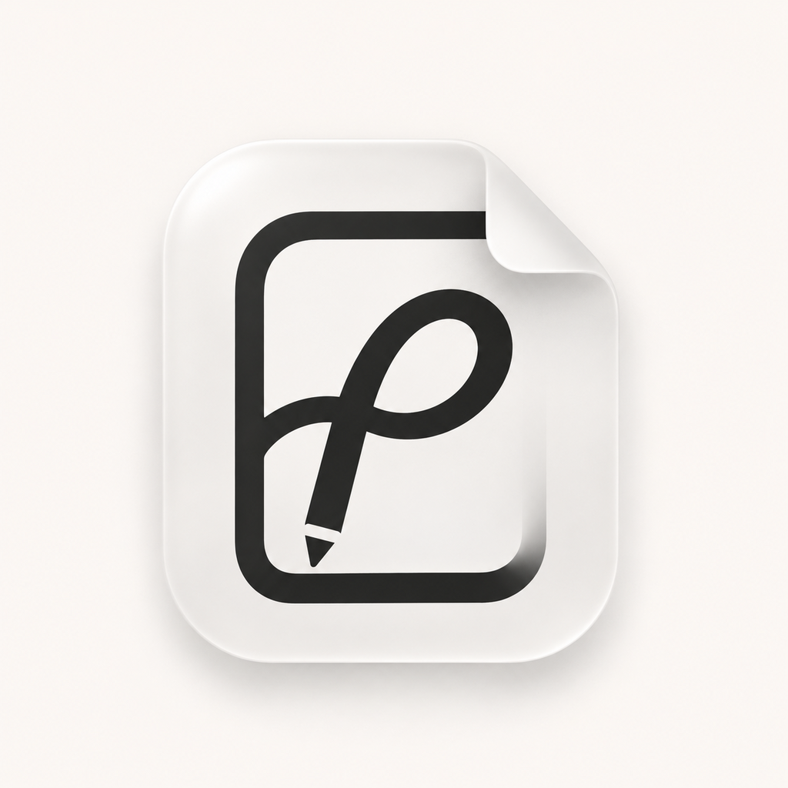
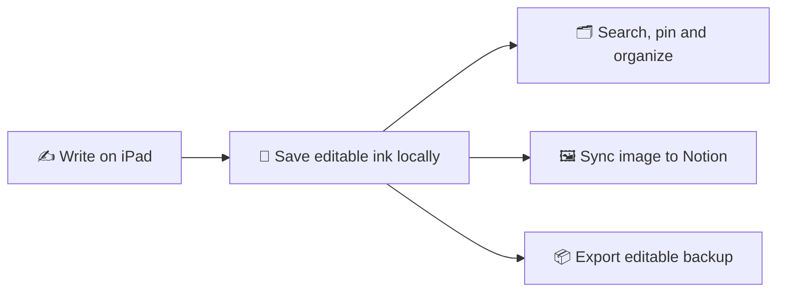
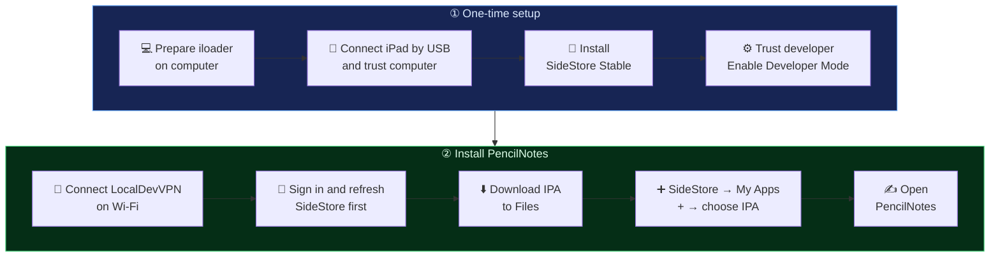
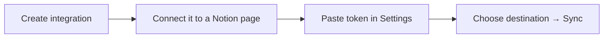

  <picture>
    <source media="(prefers-color-scheme: dark)" srcset="PencilNotes.swiftpm/Resources/Assets.xcassets/AppIcon.appiconset/AppIcon-dark.png">
    
  </picture>

# ✍️ PencilNotes

**A small notebook for your next big idea.**

Write on iPad. Keep editable ink locally. Send an image to Notion.

[⬇️ Download IPA](https://github.com/rabbiii/Handwrite-for-Notion/releases/latest) → [📲 Install](docs/SIDESTORE.md) → [🔗 Connect Notion](docs/NOTION.md)

## 💡 Capture → organize → share

| Make it yours | Keep it organized | Take it with you |
| --- | --- | --- |
| PencilKit tools and a continuous canvas | Title search, sorting and pinned notes | Image sharing and editable backups |
| 60 icons with a searchable picker | Bulk selection, rename and delete | Optional Notion image sync |
| Gentle selected-note animation | Recently Deleted with restore | Manual sync or optional Auto Sync |

Requires **iPadOS 17+**. Apple Pencil is recommended. Finger drawing is available. Liquid Glass uses iPadOS 26+, with a material fallback.

## 📲 Install with SideStore

Releases contain an **unsigned IPA**. SideStore signs it using your Apple Account. A computer is needed for initial setup.

**[Follow the short SideStore guide →](docs/SIDESTORE.md)**

Use the same Apple Account in iloader and SideStore. Free accounts normally require refresh within seven days. Check SideStore's expiry counters. [Official SideStore FAQ](https://docs.sidestore.io/docs/faq)

## 🚀 Your first note

1. Tap **New Note** and write.
2. Tap its icon to customize it. Long-press its row to pin it.
3. Use **Library** for sorting and Recently Deleted.
4. Tap the selected row's **−** button to save and return Home.

In **Edit** mode, tap rows to select notes. Use Select All, Unselect All, or Delete. Tap outside the sidebar to finish.

## 🔗 Send handwriting to Notion

**[Notion setup →](docs/NOTION.md)**

Sync sends a PNG. Editable handwriting stays on the iPad. Changes made in Notion do not flow back into PencilNotes.

## 🔐 Your notes and privacy

| What | Where it goes |
| --- | --- |
| Editable handwriting | Local app storage |
| Integration token | Apple's Keychain |
| Synced PNG, title and link metadata | Your chosen Notion page, over HTTPS |
| Exported backup | The location you choose in Files |

No analytics or advertising SDK is included. Local saves use atomic replacement and retain a previous readable copy. Recently Deleted lets you restore removed notes.

**Export editable backups regularly.** Device loss, app removal and storage failure can still lose notes. Recently Deleted is on the same device. The app has no independent security audit or app-specific end-to-end encryption.

**[Privacy, backups and safe updates →](docs/PRIVACY.md)**

## ❤️ Made by Morsalin Islam

[✉️ Send feedback](mailto:mar.rabbi40@gmail.com) → [🐛 Report an issue](https://github.com/rabbiii/Handwrite-for-Notion/issues) → [📋 Changelog](CHANGELOG.md)

[❤️ Support PencilNotes on Patreon](https://www.patreon.com/MorsalinIslam)

Optional support helps fund App Store membership and ongoing development. PencilNotes remains free and open source.

Free and open source under the [MIT License](LICENSE). Commercial reuse is allowed under its terms. An independent project, unaffiliated with Apple or Notion.
