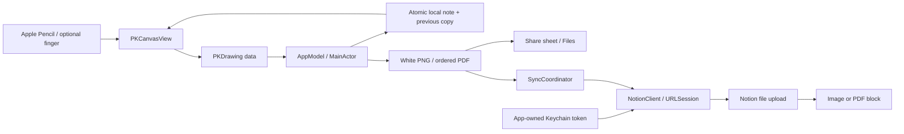

# Implementation and boundaries

## Platform

The intended target is an iPadOS 17+ App playground. SwiftUI, PencilKit, UIKit, Foundation, and Security are system frameworks. There are no package dependencies. Apple's `AppleProductTypes` manifest support is available in App-playground tooling, not the Linux Swift installation. The manual App-template route uses the manifest generated by the user's installed Swift Playground version if the supplied manifest is incompatible.

## Data flow

## Drawing and storage

Each editable page uses a 768 × 1024-point paper rectangle. A separate scroll view handles finger pan/zoom, with Pencil touches reserved for PencilKit. The tool picker supplies native tools; the editor exposes undo/redo through the canvas undo manager. Tool undo is an in-session drawing action; deleting a page requires confirmation and is not part of ink undo.

The editor replaces its canvas controller when either note or page identity changes. `PKDrawing` decoding is validated before presenting saved notes; corrupt strokes are not silently replaced with a new blank drawing. The exported page contains the union of the paper and stroke bounds, fitted proportionally into the same page size. Thus lasso-moved off-paper ink is included; unusually distant ink can reduce the resulting scale.

AppModel owns note state on MainActor. Drawing changes update the in-memory representation immediately, then save after 450 ms without further changes. Switching notes/pages, adding pages, exporting, syncing, and scene inactivity synchronously flush dirty notes. A failed flush blocks navigation that would discard the dirty note and displays a retryable error. A forced process termination before the autosave window may still lose the latest fraction of a second; explicit Save is available.

Each file is one JSON envelope `{version: 1, note: …}`. Keeping metadata and all pages in one atomic replacement prevents mismatched metadata/stroke generations. Before replacement, the previous readable version is saved atomically. JSON corruption recovers from the previous file and reports the recovery; corrupt originals are preserved before the next successful write. A structurally valid file with invalid PencilKit bytes is preserved and requires a valid editable backup. Unknown future formats are reported, not treated as blank notes. The limits are 200 pages, 20 MiB of stroke bytes per page, and 100 MiB per serialized file to bound memory use.

Backups use the same `.pencilnote` envelope, retain editable strokes, and omit credentials. Import validates the envelope and PKDrawing payloads, assigns a fresh note identity, clears remote links, and saves as a new note. Deletion explicitly removes the local note and its recovery copies, leaving remote Notion content intact.

## Authentication and requests

The owner enters an internal integration token in a SecureField. A connection check must succeed before replacing a stored token. Security.framework stores it with `kSecAttrAccessibleWhenUnlockedThisDeviceOnly`; it is never placed in UserDefaults, note JSON, source, or export files. Disconnect deletes it. No shared Keychain access group is requested.

The personal app connects directly to Notion HTTPS endpoints. There is no OAuth client secret or public distribution flow. A distributed multi-user product would need a separate authorization design. See the sourced [Notion API assessment](NOTION_API_RESEARCH.md).

The client pins the verified supported `Notion-Version: 2026-03-11`, spaces requests at least 350 ms apart per client, follows search and block pagination, guards repeated cursors, sanitizes server messages, and exposes actionable authentication, permission, size, offline, and rate-limit errors. A 429 displays Retry-After guidance; mutations are never automatically replayed.

Before a sync, `/users/me` refreshes credentials and the workspace upload limit. The app uses the lower of that limit and 20 MiB for single-part uploads, with a 5 MiB fallback if the limit is absent. PNG exports may reduce resolution down to 768 × 1024 for sync. Oversized documents fail with a local-export/split-note explanation; the app does not silently omit pages or use paid hosting.

## Sync transaction and recovery

1. Save local content and validate destination, format, and size.
2. Reuse a known block when updating. Without a block ID, search all destination children for the note/format's stable caption marker.
3. Upload the exported bytes using file-upload create/send and require confirmation of `uploaded` status.
4. For a new block, persist the pending marker **before** appending. If persistence fails, no block append occurs; an unattached upload may expire at Notion.
5. Append or update the image/PDF block, then persist its ID and the uploaded content revision.

Unchanged local revisions skip another upload. If a block has been removed remotely, the user can reset its local link and sync again; this rechecks destination children before creating a replacement. The unchanged shortcut is a record of the last successful local sync, not continuous monitoring of remote edits.

If an append response is lost, the durable marker remains. Retry scans destination children, recovers the block if visible, and updates it. If no block is visible, the app refuses to guess. It instructs the user to wait or inspect Notion before explicitly clearing the uncertainty. A pending operation cannot be discarded merely by choosing another format or page. Saved state covers the current target; normal deliberate format/destination changes retain old remote copies and search stable markers when revisiting a target. This is duplicate mitigation, not an API-level exactly-once guarantee: manual marker edits, concurrent app copies, and delayed external behavior can still require user inspection.

## Verified scope

Portable tests execute the real Foundation storage, client, and sync coordinator against temporary directories and mocked HTTP responses. They cannot prove rendering, touch recognition, Keychain entitlements, app manifest compatibility, device lifecycle behavior, or a live Notion integration. Those have an explicit [acceptance checklist](ACCEPTANCE_TESTS.md).
