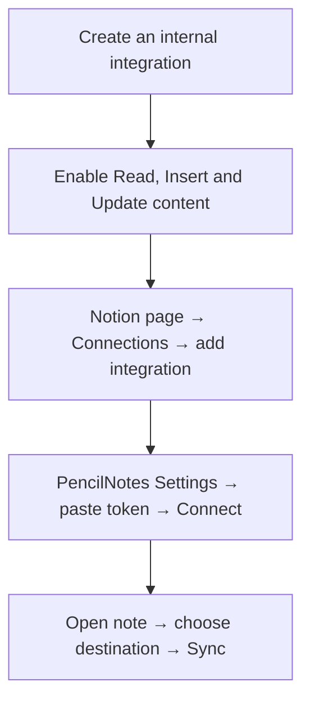

# 🔗 Connect Notion

[← README](../README.md)

1. Open [Notion integrations](https://www.notion.so/profile/integrations). Create an internal integration for your workspace.
2. Enable **Read**, **Insert** and **Update** content permissions.
3. Open your destination page in Notion. Add the integration through the page's **Connections** menu.
4. Paste its token into PencilNotes Settings. Tap **Connect Notion**.
5. Open a note. Choose the destination and tap **Sync**.

## 🖼️ What sync does

PencilNotes uploads a PNG and updates its linked image block after edits. Local handwriting stays editable. Notion changes do not sync back.

Auto Sync is optional. It needs internet and an active app. Errors can pause it; check the message before retrying.

## 🛠️ If a page is missing

Check the workspace and page connection. Search only finds pages available to your integration.

For an uncertain upload, inspect the destination before resetting its link. This helps avoid duplicate images.

Keep the token private. Disconnect removes the saved credential. Revoke an exposed token in Notion.
