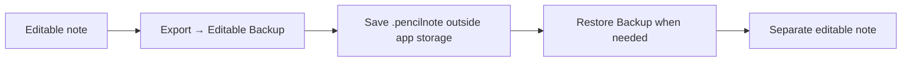

# 🔐 Privacy, backups and updates

[← README](../README.md)

## Where data lives

| Data | Storage or destination |
| --- | --- |
| Editable ink and note metadata | Local app storage |
| Notion token | Apple's Keychain |
| Synced image, title and identifying link metadata | Notion over HTTPS |
| Exported files | Your chosen share or Files destination |

The app includes no analytics or advertising SDK. Notion's policies apply to uploaded content. External links open their respective services.

## Protect your handwriting

Use **Editable Backup** to preserve strokes. PNG exports and Notion images cannot restore editable handwriting. Restoring a backup creates a separate note and clears its Notion connection.

Save backups outside the app's own folder. Keep a copy in Files, iCloud Drive or another location you control.

## Recovery and deletion

Local saves use atomic replacement and keep a previous readable version. These measures reduce risk; they do not guarantee recovery.

Deleted notes stay in **Library → Recently Deleted** until restored or permanently erased. Permanent deletion removes local recovery copies. The Notion image remains.

Recently Deleted is stored on the same device. App removal, device loss and storage failures can affect it too.

## Before an update

Export backups. Keep the same signing account and bundle identifier. Install over the existing app when possible. Confirm notes open after updating.

The project has no independent security audit or app-specific end-to-end encryption. Do not share tokens, pairing files or private notes in public issues. Report security concerns to [mar.rabbi40@gmail.com](mailto:mar.rabbi40@gmail.com).
