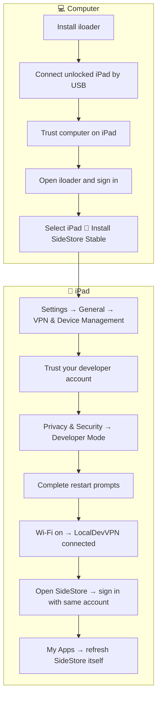
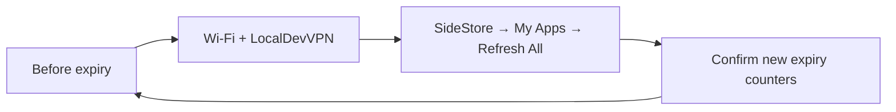

# 📲 Install PencilNotes with SideStore

[← README](../README.md) → [Download IPA](https://github.com/rabbiii/Handwrite-for-Notion/releases/latest)

## ✅ Prepare

You need an **iPad running iPadOS 17+**, a passcode, Wi-Fi, an Apple Account, a computer and a USB cable.

On Windows, install the Apple device software and iloader listed in [SideStore's prerequisites](https://docs.sidestore.io/docs/installation/prerequisites). Install **LocalDevVPN** on the iPad using that page's App Store link. Other computer platforms are covered there too.

## 💻 Set up SideStore once

Follow the prompts for your iPadOS version. Trusting an account may also require a restart. Refresh SideStore **before installing PencilNotes**. [Official installation steps](https://docs.sidestore.io/docs/installation/install)

## 📲 Install PencilNotes

1. On the iPad, open [the latest release](https://github.com/rabbiii/Handwrite-for-Notion/releases/latest).
2. Download **PencilNotes-unsigned.ipa** to Files.
3. Connect LocalDevVPN and keep Wi-Fi on.
4. In SideStore, open **My Apps → +**. Select the downloaded IPA.
5. Wait for installation. Open PencilNotes.

The optional `.sha256` asset verifies the download. Select the `.ipa` when installing.

## 🔄 Keep it working

Free accounts normally allow three active apps, including SideStore. Refresh within the seven-day signing period. Check the counters even if background refresh is enabled. [SideStore limits and refresh FAQ](https://docs.sidestore.io/docs/faq)

## 📦 Update safely

Export an **Editable Backup** first. Install the newer IPA through SideStore using the same account and app identity. Avoid uninstalling PencilNotes; removal can erase local notes.

## 🛠️ Need help?

| Problem | Next step |
| --- | --- |
| IPA will not install | Check Wi-Fi, LocalDevVPN and available app slots. |
| App expired | Refresh through SideStore. If SideStore also expired, follow its recovery guidance. |
| Pairing error after an OS update | Replace the pairing file using SideStore's current instructions. |
| Computer cannot see iPad | Unlock it, trust the computer and check the USB connection. |

Use the [official troubleshooting guide](https://docs.sidestore.io/docs/troubleshooting). Keep Apple credentials and pairing files private. PencilNotes itself does not request your Apple Account password.
